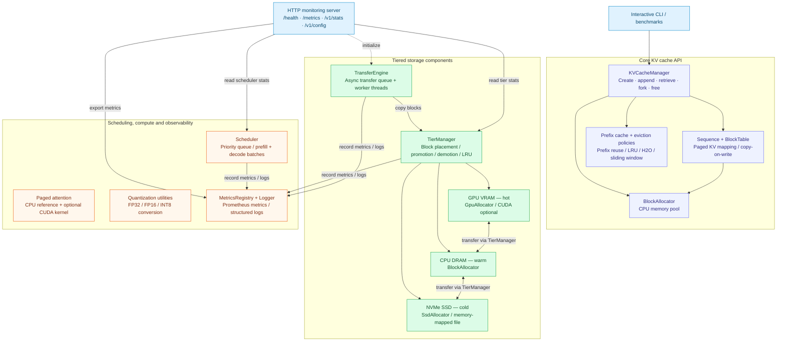

# PageForge — Production KV Cache for LLM Inference

A high-performance, **MoonCake-inspired** C++17 KV Cache system with **3-tier storage hierarchy** (GPU VRAM → CPU DRAM → NVMe SSD), CUDA PagedAttention kernels, continuous batching scheduler, and zero external dependencies.

## Architecture

High-level view of the current implementation. Arrows show component usage; dashed arrows show server initialization.



**Current integration boundaries:** The CLI uses the CPU-backed core cache API. The HTTP server initializes the tier manager, scheduler and transfer engine, but only serves monitoring/configuration endpoints; it does not run an inference loop. The core cache manager is not connected to the tier manager. Attention kernels and quantization utilities are available separately. GPU support is optional (the GPU allocator can use CPU emulation), and SSD storage is disabled in the server demo by default.

## Features

| Feature | Description |
|---------|-------------|
| **3-Tier Storage** | GPU VRAM → CPU DRAM → NVMe SSD with automatic LRU promotion/demotion |
| **CUDA PagedAttention** | GPU-accelerated attention with paged block table (Ada Lovelace optimized) |
| **Transfer Engine** | Async thread pool for GPU↔CPU↔SSD data movement |
| **Continuous Batching** | Dynamic batch management with priority scheduling and preemption |
| **PagedAttention** | OS-inspired paged memory — near-zero fragmentation (<4%) |
| **Copy-on-Write** | Efficient sequence forking for beam search |
| **Eviction Policies** | LRU, H2O (Heavy Hitter), Sliding Window (StreamingLLM) |
| **Quantization** | FP32 → FP16/INT8 with accuracy metrics (MAE, SQNR) |
| **Prefix Caching** | Hash-based prefix sharing across sequences |
| **HTTP API** | REST endpoints with Prometheus metrics |
| **Structured Logging** | Thread-safe, level-filtered, file + console |
| **Zero Dependencies** | Pure C++17 — CUDA optional |

## Hardware Target

Optimized for:
- **GPU**: NVIDIA RTX 3050A (4GB GDDR6, Ada Lovelace, CC 8.9)
- **RAM**: 24GB DDR5
- **Storage**: 512GB NVMe SSD

**Capacity** (FP16, 32 layers, 8 heads, 128 dim):
| Tier | Storage | Tokens | Role |
|------|---------|--------|------|
| GPU  | 3 GB    | ~24K   | Active decode (hot) |
| CPU  | 16 GB   | ~128K  | Recently used (warm) |
| SSD  | 100 GB  | ~800K  | Long-context (cold) |
| **Total** | **119 GB** | **~952K** | |

## Quick Start

### Build

```bash
mkdir build && cd build
cmake .. -DCMAKE_BUILD_TYPE=Release
cmake --build .
```

CUDA is auto-detected. If not found, builds in CPU-only mode.

### Run Tests

```bash
ctest --output-on-failure
```

### Run CLI

```bash
./pageforge_cli
```

### Run API Server

```bash
./pageforge_server 8080

# In another terminal:
curl http://localhost:8080/health
curl http://localhost:8080/v1/stats
curl http://localhost:8080/metrics
```

## API Endpoints

| Method | Path | Description |
|--------|------|-------------|
| GET | `/health` | Health check |
| GET | `/metrics` | Prometheus metrics (text format) |
| GET | `/v1/stats` | Tier utilization & scheduler stats (JSON) |
| GET | `/v1/config` | Current configuration (JSON) |

## Project Structure

```
PageForge/
├── CMakeLists.txt                   # CUDA-aware build system
├── config.json                      # Example production config
├── README.md
│
├── include/kvcache/                 # Public headers
│   ├── kvcache.h                    # Umbrella include
│   ├── types.h                      # Core types & enums
│   │
│   │── ── Core (v1) ──
│   ├── block_allocator.h            # Paged block pool
│   ├── block_table.h                # Logical→physical mapping
│   ├── sequence.h                   # Per-request KV state
│   ├── eviction_policy.h            # LRU/H2O/SlidingWindow
│   ├── quantization.h               # FP16/INT8 utils
│   ├── prefix_cache.h               # Prefix sharing
│   ├── cache_manager.h              # v1 orchestrator
│   │
│   │── ── Production (v2) ──
│   ├── config.h                     # Runtime configuration
│   ├── logger.h                     # Structured logging
│   ├── metrics.h                    # Prometheus counters/gauges
│   ├── gpu_allocator.h              # GPU VRAM block pool
│   ├── ssd_allocator.h              # NVMe mmap block pool
│   ├── tier_manager.h               # 3-tier orchestrator
│   ├── transfer_engine.h            # Async data movement
│   ├── attention.h                  # CPU attention fallback
│   ├── scheduler.h                  # Continuous batching
│   └── cuda/
│       └── paged_attention.cuh      # CUDA kernel
│
├── src/                             # Implementations
│   ├── (7 core + 8 production .cpp files)
│   └── cuda/
│       └── paged_attention.cu       # CUDA kernel
│
├── cli/main.cpp                     # Interactive CLI
├── server/main.cpp                  # HTTP API server
├── tests/                           # 45+ tests
└── benchmarks/                      # Throughput benchmarks
```

## Configuration

See [config.json](config.json) for all options. Key parameters:

| Parameter | Default | Description |
|-----------|---------|-------------|
| `gpu_memory_bytes` | 3 GB | GPU VRAM budget for KV cache |
| `cpu_memory_bytes` | 16 GB | CPU DRAM budget |
| `ssd_capacity_bytes` | 100 GB | NVMe SSD budget |
| `gpu_eviction_threshold` | 90% | Start GPU→CPU demotion |
| `cpu_eviction_threshold` | 85% | Start CPU→SSD demotion |
| `max_batch_size` | 32 | Max concurrent sequences |
| `num_transfer_threads` | 4 | Async transfer workers |

## Prometheus Metrics

```
pageforge_total_requests 42
pageforge_total_tokens 1337
pageforge_gpu_blocks_used 150
pageforge_cpu_blocks_used 800
pageforge_ssd_blocks_used 3000
pageforge_gpu_util_pct 85.50
pageforge_total_transfers 25
pageforge_transfer_latency_us_bucket{le="100"} 20
```

## Comparison with MoonCake

| Feature | PageForge | MoonCake (Moonshot AI) |
|---------|-----------|----------------------|
| 3-Tier Storage | ✅ GPU/CPU/SSD | ✅ GPU/CPU/SSD |
| PagedAttention | ✅ | ✅ |
| Prefix Caching | ✅ | ✅ |
| Copy-on-Write | ✅ | ✅ |
| Continuous Batching | ✅ | ✅ |
| CUDA Kernels | ✅ (single GPU) | ✅ (multi-GPU) |
| Eviction Policies | ✅ LRU/H2O/SW | ✅ |
| Quantization | ✅ FP16/INT8 | ✅ |
| **Distributed** | ❌ Single node | ✅ Multi-node RDMA |
| **Scale** | Laptop/workstation | Data center |
| **Dependencies** | Zero | RDMA, gRPC, etc. |

## License

MIT
